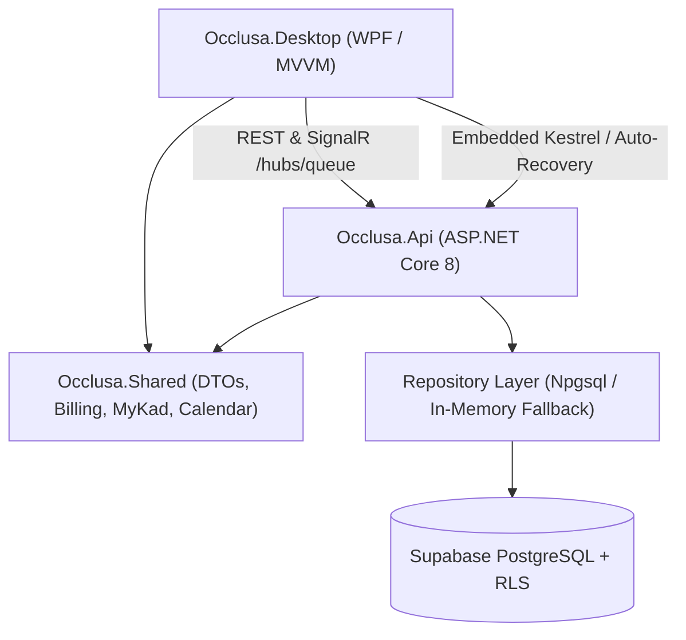

# Occlusa — Malaysian Dental Practice Management Software

> A .NET 8 dental clinic operations platform for multi-branch Malaysian practices combining a zero-scrollbar WPF desktop client (`Occlusa.Desktop`), an ASP.NET Core 8 Web API & SignalR backend (`Occlusa.Api`), pure domain contracts/helpers (`Occlusa.Shared`), and Supabase PostgreSQL Row-Level Security (`Occlusa.Tests` verified).

---

## Table of Contents
- [Architecture Overview](#architecture-overview)
- [Project Structure](#project-structure)
- [Core Architectural Invariants](#core-architectural-invariants)
- [Features](#features)
- [Prerequisites](#prerequisites)
- [Getting Started & Quick Start](#getting-started--quick-start-zero-config-local-mode--0-cost)
- [Running Tests](#running-tests)
- [Production Configuration Guide](#production-configuration-guide)

---

## Architecture Overview



| Component | Path | Purpose |
| :--- | :--- | :--- |
| **Shared Domain & Math** | `src/Occlusa.Shared` | Cross-platform `net8.0` DTOs, enums, `AppointmentCalendarHelper` (calendar grids, slot availability, treatment capability & flexible patient matching), `ResponsiveTableColumnPlanner` (priority-adaptive single-line column budgeting), deterministic `BillingCalculator`, Malaysian `MyKadParser`, and `EmergencyTriageClassifier`. |
| **Web API & SignalR Hub** | `src/Occlusa.Api` | ASP.NET Core 8 REST API, SignalR `/hubs/queue`, `InMemoryOcclusaRepository` (0-config fallback) / `NpgsqlSupabaseRepository`, and WhatsApp AI Receptionist. |
| **Native WPF Desktop** | `src/Occlusa.Desktop` | `net8.0-windows` desktop client styled with the centralized **Calm Dental 60-30-10 Color System** (`Themes/UniformTheme.xaml` + `Themes/CalmThemePalette.cs`), panel-fitted priority-adaptive single-line paged tables (`UniformPagedGrid` + `ResponsiveTableColumnPlanner`: zero scrollbars, zero ellipsis truncation, zero clipping), 1280p/1080p/1440p responsiveness, `LocalApiHostService` embedded in-process Kestrel host with auto-recovery, true modal dialogs with unsaved-changes guard, modal-pinned medical alerts, full-width Simple-by-Default / Detailed opt-in Live Queue with appointment reminders & per-user `⚙ My View` settings, shared Walk-In intake & Active Staff attribution, per-visit anatomical 52-tooth FDI odontogram (5-surface charting), 15-minute proportional Appointments timeline with drag-and-drop rescheduling, and PC/SC MyKad reader. |
| **xUnit Test Suite** | `src/Occlusa.Tests` | 106 deterministic unit, UI contract, and Kestrel HTTP pipeline tests covering Calm Dental color-system & single-primary-CTA enforcement, responsive priority-adaptive table column planning, Simple/Detailed Live Queue filtering, hybrid WhatsApp/manual reminders & EN/BM auto-confirmation, per-user workspace preferences, Live Queue sorting, reception note formatting & walk-in note lifecycle persistence, Walk-In slot blocking, staff attribution, appointments, 15-minute timeline layout & overlap splitting, dentist-locked drag rescheduling, treatment capability filtering, patient lookup, unified Master Catalogue syncing, decoupled billing & OTC 0% commission, shared patient credit wallet, smart invoice suggestions, NRIC parsing, and WhatsApp emergency triage. |
| **Supabase Schema & RLS** | `supabase/migrations/` | PostgreSQL schema migrations (`001` core schema & RLS, `002` dentists/treatments/appointments relations, `003` dentist treatment capabilities, `004` live queue walk-ins & staff attribution, `005` patient visits & per-visit odontograms, `006` unified Master Catalogue, decoupled billing, shared patient credit wallet & doctor invoice settings, `007` appointment reminder tracking & per-user workspace view preferences) with clinic-group clinical sharing, branch-isolated financials, and immutable append-only audit logs. |
| **Architecture Docs** | `docs/` | UI uniformity rules (`docs/UI_UNIFORMITY_RULES.md`), Appointments scheduling specification (`docs/architecture/APPOINTMENTS_SCHEDULING.md`), and step-by-step Clinical Notes & Invoicing walkthrough (`docs/NOTES_AND_INVOICING_WALKTHROUGH.md`). |
| **Backup Verification** | `scripts/verify-daily-backup.ps1` | Daily AES-256 encrypted `pg_dump` / dry-run archive verification with SHA-256 checksums and API logging. |

---

## Project Structure

```text
├── .agents/
│   └── rules/
│       └── calm-dental-color-system.md    # Always-on 60-30-10 Calm Dental color system rule
├── docs/
│   ├── architecture/
│   │   └── APPOINTMENTS_SCHEDULING.md     # Relational calendar & 4-step booking architecture
│   ├── NOTES_AND_INVOICING_WALKTHROUGH.md # Step-by-step clinical notes & invoicing guide
│   └── UI_UNIFORMITY_RULES.md             # Zero-scrollbar / zero-ellipsis & Calm Dental UI contract
├── scripts/
│   └── verify-daily-backup.ps1        # Encrypted backup verification runner
├── src/
│   ├── Occlusa.Api/                   # ASP.NET Core 8 REST API & SignalR hub
│   │   ├── Controllers/
│   │   ├── Hubs/
│   │   ├── Models/
│   │   ├── Options/
│   │   ├── Properties/
│   │   ├── Repositories/
│   │   ├── Security/
│   │   └── Services/
│   ├── Occlusa.Desktop/               # Native WPF desktop client (MVVM)
│   │   ├── Controls/
│   │   ├── Services/
│   │   ├── Themes/                    # UniformTheme.xaml & CalmThemePalette.cs (60-30-10 tokens)
│   │   ├── ViewModels/
│   │   └── Views/
│   ├── Occlusa.Shared/                # Pure domain models & scheduling/billing helpers
│   │   ├── Models/
│   │   └── Services/
│   └── Occlusa.Tests/                 # xUnit verification suite (106 tests)
├── supabase/
│   └── migrations/
│       ├── 001_occlusa_tier1_tier2_schema_rls.sql
│       ├── 002_appointments_dentists_treatments.sql
│       ├── 003_dentist_treatment_capabilities.sql
│       ├── 004_live_queue_walkins_and_attribution.sql
│       ├── 005_patient_visits_and_visit_odontograms.sql
│       ├── 006_decoupled_billing_credits_and_settings.sql
│       └── 007_reminders_and_user_preferences.sql
├── CHANGELOG.md                       # SemVer release history
├── Directory.Build.props              # Synchronized SemVer version metadata
├── Occlusa.sln                        # Visual Studio / .NET solution
└── README.md                          # Project overview & setup guide
```

---

## Core Architectural Invariants

1. **Zero Scrollbars, Zero Ellipsis (`...`), & Panel-Fitted Atomic Columns:** Desktop views and modals paginate cleanly (`UniformPagedGrid`, auto-sized for 1920x1080 and 2560x1440) with strict single-line `36px` rows, unlimited priority-ordered atomic columns that automatically fit the host panel width without clipping (`ResponsiveTableColumnPlanner`), hover tooltips, and double-click modal popups (`ModalDialogShell` with `HasUnsavedChanges` guard).
2. **Clinical Sharing vs. Financial Isolation (RLS):** Clinical data (`patients`, `medical_alerts`, `odontogram_entries`, `soap_notes`) is shared across branches within the same `clinic_group_id` (`OCCLUSA-MY`), while financial records (`invoices`, `invoice_lines`, `payments`, `daily_sales_reconciliations`, `audit_logs`) are strictly isolated by `branch_id = ANY(auth_allowed_branches())`.
3. **Immutable History (Soft-Delete / Void Only):** Hard `DELETE` is prohibited on `invoices`, `invoice_lines`, `payments`, `soap_notes`, `daily_sales_reconciliations`, `patients`, and `audit_logs`. Voiding an invoice preserves the record and appends an immutable `AuditLogDto`.
4. **Unified Master Catalogue & Strictly Decoupled Clinical Notes / Smart Invoicing:** One unified **Master Catalogue** (`billing_catalog_items`) powers Appointment Booking, Odontogram Quick Presets, Doctor Suggestion Rules, Invoice Checkout, Walk-In OTC Retail Sales, and WhatsApp AI quotes. Clinical Visit Records (`patient_visits`, `visit_odontogram_entries`) store **zero monetary amounts** so reception edits on unpaid Draft Invoices never mutate or contradict a doctor's clinical report. At checkout, `InvoiceSuggestionEngine` combines per-doctor Settings (`Auto-Populate`, `Blank + Suggestions`, or `Manual Blank`), Treatment → Companion rules, and SOAP note keyword scanning, while Over-The-Counter (`OtcProduct`) items enforce `0%` doctor commission and overpayments can be returned as cash change or stored in a clinic-group shared **Patient Credit Wallet**.
5. **WhatsApp AI Receptionist Guardrails:**
   - Every AI-created booking enters the queue as `QueueStatus.AiBookedPending` for front-desk approval.
   - Routine scope only (hours, clinic locations, standard Consultation/Scaling/Filling rates & slots). Complex/surgical requests (implants, wisdom tooth surgery, full-mouth rehab, braces, sedation) are blocked from self-booking and routed to front-desk callback.
   - Emergency red-flag symptoms (severe pain, facial swelling, uncontrolled bleeding, trauma, airway/swallowing difficulty) immediately halt booking, set `IsEmergencyEscalated = true`, and emit `EmergencyEscalated` via SignalR.
6. **Treatment-Driven 4-Step Front-Desk Appointment Booking:** Appointments match front-desk workflow order (`Treatment` -> eligible `Dentist` via `SupportedTreatmentIds` -> target `Date` & 3x3 hourly slot availability grid -> flexible `IC`/`Name`/`Phone` auto-suggest lookup with inline new-patient registration), keeping `MedicalAlertsBanner` hidden on the main Appointments overview until a specific patient is selected inside a modal or clinical workspace.
7. **Calm Dental 60-30-10 Color System:** All desktop XAML and code-behind colors resolve exclusively from the centralized 17-token palette in `Themes/UniformTheme.xaml` and `Themes/CalmThemePalette.cs` (`#F7FAFA` canvas, `#FFFFFF` cards, `#EDF3F3` sidebar/table headers/row hovers, `#D8E3E3` borders, `#182929`/`#566B6B` text with zero pure `#000000`, `#069494`/`#057878`/`#E3F4F4` teal brand accents, and soft semantic feedback pairs), enforcing strictly one primary CTA per active view/modal and verified automatically by `Occlusa.Tests`.

---

## Features

- [x] **Full-Width Simple-by-Default Live Queue, Appointment Reminders & Per-User View Settings:** Full-width, strict single-line `36px` Live Queue with responsive priority-ordered columns defaulting to a calm **Simple View** (`Time` · `Patient` · `Treatment` · `Doctor` · `Room` · `Duration` · `Reminder` · `Status`), role-smart `My Queue` / `All Clinic` scoping, `Active Only` filtering, and 1 smart contextual Next-Step CTA. Staff can opt into a detail-rich **Detailed Operations View** (`Appt Time` · `Arrived` · `Type` · `Patient` · `IC / MyKad` · `Treatment` · `Duration` · `Doctor` · `Room` · `Reception Note` · `Reminder` · `Status` with live wait/chair timers, doctor/status filter chips, full stage buttons, and optional full MyKad bar) via **`⚙ My View`** beside `ACTIVE STAFF`, persisted per user (`user_workspace_preferences`). Includes hybrid bilingual EN/BM WhatsApp + manual Call/SMS appointment reminders (`AppointmentReminderModal`, `AppointmentDetailModal`, and automatic WhatsApp `"Yes/Ya/Confirm"` confirmation), shared `+ Walk-In` intake, `ACTIVE STAFF` attribution trails, compact `[ALERT]` row badges, and modal-pinned `MedicalAlertsBanner`.
- [x] **Appointments Calendar & Table:** 15-minute proportional timeline (`4 rows/hour`) in **Day View** and **Week View** (`Full Day` / `AM` / `PM`) with overlap lane splitting and dentist-locked cross-date drag-and-drop rescheduling, plus **Month View** and priority-adaptive paged Table synced with Live Queue (`IsTodayForLiveQueue`).
- [x] **4-Step Booking & Inline Registration:** Treatment-to-dentist capability filtering, hourly slot availability lookup, dash-tolerant IC / name / phone search, and atomic `POST /api/appointments/register-and-book`.
- [x] **Patient Registry & Per-Visit Records (MDA / MDC / KKM):** Patients hold `0..N` visit records. Reception can register standalone patients (`+ Register Patient`, 0 visits); seating an appointment `InChair` auto-creates a linked visit, and clinicians can add `+ New Visit Record` manually. `PatientDetailModal` shows editable demographics plus a panel-fitted paged visit grid; each visit opens `VisitRecordModal` with its own SOAP notes and **its own independent odontogram**. Historical edits are allowed and audited (`PATIENT_VISIT_UPDATED`, `VISIT_ODONTOGRAM_UPDATED`), while settled invoices are never mutated.
- [x] **Kreloses-Style Anatomical Odontogram (52 FDI teeth):** `AnatomicalToothControl` renders crown + root vector silhouettes with a midline-aware 5-surface (`M`, `O/I`, `D`, `B`, `L`) occlusal chart for Permanent (`11–48`) and Primary (`51–85`) dentition. New visits carry forward the prior visit's chart (completed work becomes an RM 0 baseline, completed extractions become `Missing`, unfinished Proposed/Accepted items carry intact), with `Reset to Blank` / `Re-Sync Prior Visit`. Tooth outlines adapted from [ZoliQua/React-Advanced-Odontogram](https://github.com/ZoliQua/React-Advanced-Odontogram) (MIT).
- [x] **Unified Master Catalogue & Decoupled Smart Invoicing:** Single **Master Catalogue** workspace powering Appointments, Odontogram Quick Presets, Doctor Suggestion Rules, Invoice Checkout, Walk-In OTC Sales (`0%` commission), and live WhatsApp AI fee quotes. Dentists record zero-price clinical visit reports and initiate Draft Invoices (`Save & Create Invoice →` / `Checkout / Invoice`) with deterministic SOAP keyword & companion suggestions and medical alert warnings; receptionists edit drafts freely, redeem or store overpayments in a cross-branch **Patient Credit Wallet**, and settle split/panel payments with automatic queue completion.
- [x] **Malaysian MyKad PC/SC Reader:** Hardware USB smartcard parsing via `winscard.dll` plus built-in **Simulate MyKad Insert** for testing.
- [x] **WhatsApp AI Receptionist & Emergency Triage:** Guardrailed booking flow with front-desk approval and SignalR emergency escalation.
- [x] **Zero-Config Local Mode & Embedded API Host:** `Occlusa.Desktop` probes `http://localhost:5188/api/health` for an external API or hosts `Occlusa.Api` in-process on Kestrel with ephemeral loopback port fallback (`http://127.0.0.1:0`) and transparent `HttpRequestException` recovery.

---

## Prerequisites

- [.NET 8 SDK](https://dotnet.microsoft.com/download/dotnet/8.0) or newer (Windows required for building/running `Occlusa.Desktop`)
- PowerShell 5.1+ or PowerShell 7+ (for backup verification script)

---

## Getting Started & Quick Start (Zero-Config Local Mode — $0 Cost)

When `Supabase:ConnectionString`, `Gemini:ApiKey`, and `WhatsApp:AccessToken` are left empty, Occlusa runs completely locally using pre-seeded Malaysian dental clinic data (`HQ-KL` and `PJ-SS2`), a deterministic AI receptionist fallback, and simulated/PC/SC MyKad reading.

1. **Clone the repository:**
   ```powershell
   git clone https://github.com/badrolazim/Occlusa.git
   cd Occlusa
   ```

2. **Build the solution:**
   ```powershell
   dotnet build Occlusa.sln
   ```

3. **Run the WPF Desktop Client (`LocalApiHostService` reuses a running API on `http://localhost:5188` or hosts `Occlusa.Api` in-process via Kestrel):**
   ```powershell
   dotnet run --project src\Occlusa.Desktop\Occlusa.Desktop.csproj
   ```

   *(Optional)* Run the API and Desktop client in separate terminals if developing backend changes independently:
   ```powershell
   # Terminal 1: Start API on http://localhost:5188
   dotnet run --project src\Occlusa.Api\Occlusa.Api.csproj

   # Terminal 2: Start WPF Desktop Client
   dotnet run --project src\Occlusa.Desktop\Occlusa.Desktop.csproj
   ```

---

## Running Tests

Run the full automated verification suite (`99` xUnit tests):

```powershell
dotnet test src\Occlusa.Tests\Occlusa.Tests.csproj --logger "console;verbosity=normal"
```

---

## Production Configuration Guide

Never commit real credentials. Configure secrets using `src/Occlusa.Api/appsettings.Development.json` (gitignored), `dotnet user-secrets`, or environment variables.

### 1. Supabase Pro PostgreSQL + RLS
1. Run the SQL migrations in order in the Supabase SQL Editor or via Supabase CLI (`supabase db push`):
   1. `supabase/migrations/001_occlusa_tier1_tier2_schema_rls.sql`
   2. `supabase/migrations/002_appointments_dentists_treatments.sql`
   3. `supabase/migrations/003_dentist_treatment_capabilities.sql`
   4. `supabase/migrations/004_live_queue_walkins_and_attribution.sql`
   5. `supabase/migrations/005_patient_visits_and_visit_odontograms.sql` (creates `patient_visits` & `visit_odontogram_entries`, links `appointments`/`invoices` via `visit_id`, and idempotently backfills legacy `soap_notes` / `odontogram_entries`)
   6. `supabase/migrations/006_decoupled_billing_credits_and_settings.sql` (adds unified Master Catalogue `billing_catalog_items`, `doctor_invoice_preferences`, `patient_credit_ledger`, walk-in retail invoice support, and OTC commission columns)
   7. `supabase/migrations/007_reminders_and_user_preferences.sql` (adds appointment reminder tracking columns on `appointments` and per-staff `user_workspace_preferences` with clinic-group RLS)
2. Set `Supabase:ConnectionString` (Transaction/Session Pooler connection string) in `appsettings.Development.json` or environment variable `Supabase__ConnectionString`.
3. Ensure your authentication JWTs include `clinic_group_id` (e.g. `"OCCLUSA-MY"`) and `allowed_branches` (e.g. `["HQ-KL"]`). `Occlusa.Api` automatically calls `set_config('request.jwt.claims', ...)` per transaction.

### 2. Meta WhatsApp Cloud API
Configure:
- `WhatsApp:VerifyToken` — token verified on `GET /api/webhooks/whatsapp`
- `WhatsApp:AccessToken` — Meta Cloud API permanent/system user token
- `WhatsApp:PhoneNumberId` — WhatsApp Business Phone Number ID
- Point your Meta App Webhook callback to `https://<your-domain>/api/webhooks/whatsapp`.

### 3. Google Gemini API (AI Receptionist Function Calling)
Configure:
- `Gemini:ApiKey` — Google AI Studio / Gemini API key
- `Gemini:Model` — e.g. `gemini-2.5-flash` (default)

### 4. Malaysian MyKad PC/SC Reader
- Plug in any Windows PC/SC-compatible USB smartcard reader (e.g., ACS ACR38U / ACR39U). `Occlusa.Desktop` uses native `winscard.dll` P/Invoke to detect card insertion and issue JPN MyKad APDUs parsed via `MyKadParser`.
- If no physical hardware reader is connected, use the built-in **Simulate MyKad Insert** button in the Patients view for instant zero-typo testing.

### 5. Automated Daily Backup Verification
Run a dry-run local verification or a live Supabase `pg_dump` AES-256 verification:
```powershell
# Dry-run check (posts verification record to running Occlusa.Api)
.\scripts\verify-daily-backup.ps1 -DryRun -ApiBaseUrl http://localhost:5188

# Live encrypted pg_dump verification
$env:OCCLUSA_SUPABASE_CONNECTION_STRING = "postgresql://postgres.<ref>:<password>@aws-0-ap-southeast-1.pooler.supabase.com:5432/postgres"
$env:OCCLUSA_BACKUP_PASSPHRASE = "<strong-passphrase>"
.\scripts\verify-daily-backup.ps1 -ApiBaseUrl http://localhost:5188
```
